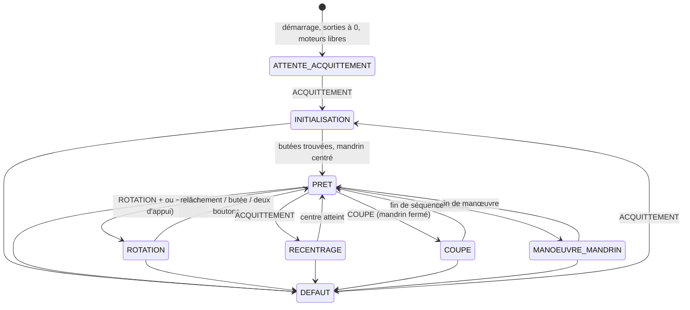

# Vitis Optima — indus V3 · Document de logique

Version 3.1 — 2026-10-27. Validée par Julien le 2026-10-27 (3.1 : initialisation en deux
passes, rapide puis lente, de chaque côté).

Ce document fige la logique de pilotage du prototype indus V3. Il est la référence :
`config.py` porte les valeurs, le code implémente ce qui est écrit ici, rien d'autre.
L'historique des écarts avec la V2 et le pourquoi des décisions sont dans
`CHANGEMENTS_V3.md`. La logique V2 reste lisible dans `../indus_V2/LOGIQUE.md`.

⚠ = valeur ou attribution à mesurer pendant les essais.

---

## 1. La machine en une page

Deux postes **mère** et **fille**, **totalement indépendants** : aucun ne dépend de l'état
de l'autre. Chacun possède :

- un **mandrin** pneumatique (EV 1 bobine) qui serre la branche — c'est le bridage ;
- une **coupe** (EV 1 bobine) — descend la lame puis la remonte ;
- un **moteur** NEMA 24 (StepperOnline 24IP65-30, driver JK-DM860H), arbre parallèle au
  sol, qui fait **tourner le mandrin** entre deux butées, **HORAIRE** et **ANTIHORAIRE**,
  chacune matérialisée par une fin de course. Plage ≈ 130° ⚠ ;
- un **guide de translation** sur lequel l'opérateur avance et recule le bloc moteur **à
  la main**. Aucun capteur : le logiciel ne connaît pas la position du bloc.

Quatre boutons par poste : **BRIDAGE**, **ROTATION +**, **ROTATION −**, **COUPE**. Plus un
bouton **ACQUITTEMENT** commun. Aucun voyant. Un buzzer.

Le mandrin n'a **pas de joint tournant** pneumatique : son tuyau suit la rotation. Sortir
de la plage l'arracherait. C'est la contrainte de sécurité principale de la V3 (§ 6).

L'arrêt d'urgence est câblé en dur et coupe tout, y compris la Raspberry Pi. Le logiciel
ne le voit pas : au réarmement, le programme repart de zéro.

### Le cycle opérateur, poste par poste

| Étape | Opérateur | Machine |
|---|---|---|
| 1 | BRIDAGE | le mandrin se ferme sur la branche |
| 2 | avance le bloc à la main | — |
| 3 | maintient ROTATION + ou − | le mandrin tourne tant que le bouton est maintenu, s'arrête au relâchement ou sur une butée |
| 4 | COUPE | séquence de coupe (interdite mandrin ouvert) |
| 5 | recule le bloc à la main | — |
| 6 | BRIDAGE | le mandrin s'ouvre, la branche est récupérée |

Rien ne s'enchaîne tout seul : l'opérateur choisit chaque action, dans l'ordre qu'il veut.
Le logiciel fait confiance à l'opérateur pour la translation (bloc reculé avant la coupe
et avant l'ouverture). Le retour du mandrin au centre ne se fait **que** sur ACQUITTEMENT.

---

## 2. Ce qui est repris de la V2, ce qui change

**Repris tel quel** — éprouvé sur la machine V2 :
- la règle « **une commande d'actionneur n'est jamais instantanée** » : toute action a une
  durée, l'état de l'actionneur ne change qu'à la fin, le poste est occupé pendant ce temps ;
- **un thread d'impulsions par moteur** qui ne touche que sa broche PUL ; la boucle
  principale lit les capteurs à 250 Hz et pose le drapeau d'arrêt ; aucun verrou ;
- le **budget de pas** : borne dure de chaque mouvement, le thread s'arrête de lui-même ;
- les rampes **en S** (demi-cosinus) ;
- l'anti-rebond des boutons par temps de stabilité, action sur **front d'appui** ;
- le bus I2C, les MCP23017, la relecture périodique de leur configuration (D7), le chemin
  d'arrêt unique, le journal tournant, les compteurs à écriture atomique.

**Changé** :

| V2 | V3 |
|---|---|
| un coordinateur arbitre les deux postes (maître / esclave) | plus d'arbitre : `machine.py` ne fait que distribuer les entrées, gérer ACQUITTEMENT et les défauts du bus |
| état global MARCHE / DÉFAUT | **état par poste** ; seuls les défauts du bus (D6, D7) touchent les deux postes |
| mouvement d'une fin de course à l'autre, sur un appui | **rotation au maintien**, arrêt au relâchement ; mouvement **vers une position** pour le centrage |
| position = « sur quelle fin de course » | **position comptée en pas**, recalée sur chaque butée |
| les deux axes ne bougent jamais ensemble | les deux moteurs **tournent en même temps** |

### 2.1 Deux threads d'impulsions en même temps

À 6400 pas/tr et 10°/s, chaque moteur demande 178 pas/s, soit 356 pas/s pour les deux. La
V2 tenait 600 pas/s sur un seul thread : la charge est inférieure. Les deux réglages de
l'interpréteur de la V2 (`sys.setswitchinterval`, `gc.freeze()`) sont gardés.

Une pause bloquante de la boucle retarde la lecture des capteurs **des deux postes**. La V2
en faisait deux (10 ms après ENA, 5 ms après DIR) : acceptable quand un seul axe bouge, pas
quand l'autre tourne. En V3, les moteurs restent excités en permanence (plus de pause ENA),
et la pause DIR → premier pas est faite **par le thread** avant son premier pas, pas par la
boucle. **Plus aucune attente bloquante dans la boucle.**

---

## 3. États d'un poste

Chaque poste a sa propre machine à états. Les deux tournent dans la même boucle, sans se
voir.



L'état du mandrin est porté à part : `OUVERT` → `EN_MANOEUVRE` → `FERME`, et retour. Il ne
change qu'à l'échéance de la manœuvre (règle du § 2).

### 3.1 Initialisation — deux butées puis centrage

Sur ACQUITTEMENT, depuis ATTENTE_ACQUITTEMENT ou DEFAUT. Les deux postes s'initialisent
**en même temps**, chacun à son rythme.

1. **Ouverture du mandrin** : relais à 0. S'il était fermé ou en manœuvre, attente de
   `TEMPS_MANOEUVRE_MANDRIN_S` avant tout mouvement (la branche ne doit pas être vrillée).
2. **Excitation du moteur** (ENA ← excité). Il le restera jusqu'à un défaut ou l'arrêt.
3. **Première butée** (sens `INIT_PREMIER_SENS`), en **deux passes** (validé le 2026-10-27) :
   - **passe rapide** à `VITESSE_RECHERCHE_RAPIDE`, rampe en S au démarrage, arrêt sur la
     butée : on la trouve grossièrement. Déjà sur cette butée : passe sautée.
     Budget : plage nominale + marge → sinon **D8** ;
   - **recul** : le moteur quitte la butée, puis recule encore de `RECUL_CONFIRMATION_DEG`
     **compté depuis le relâchement** du galet. Butée toujours active après
     `DEGAGEMENT_MAX_DEG` → **D4**. (Trouvé sur banc logiciel : après un D1, le mandrin peut
     être jusqu'à la marge derrière sa butée, un recul fixe de 5° ne la relâchait pas.) ;
   - **passe lente** de confirmation à `VITESSE_RECHERCHE_LENTE`, sans rampe, arrêt sur la
     butée. Budget : recul + `TOLERANCE_CONFIRMATION_DEG` → sinon **D8**.
     **C'est cet arrêt lent qui fixe la position 0** (ou `plage`).
4. **Seconde butée**, sens opposé, mêmes trois temps. La position de l'arrêt lent **est la
   plage mesurée**.
5. **Contrôle de la plage** : écart à `PLAGE_NOMINALE_DEG` supérieur à
   `PLAGE_TOLERANCE_DEG` → **D9**.
6. **Centrage** : mouvement jusqu'à la moitié de la plage mesurée (§ 8.3), à
   `VITESSE_RECENTRAGE`.
7. Double bip, journal (plage mesurée, écart passe rapide / passe lente) → **PRET**.

Durée au pire (plage 130°, départ sur la seconde butée, passes à 20°/s et 3°/s, recul 5°,
centrage à 10°/s) : 2 × (6,5 s + 0,5 s + 1,7 s) + 6,5 s ≈ 24 s.

### 3.2 Repère de position

`position` = nombre de pas depuis la butée ANTIHORAIRE, compté par le thread, signé par le
sens. 0 = butée antihoraire, `plage` = butée horaire. **Recalée** à chaque arrivée sur une
butée (0 ou `plage`). Un écart au recalage supérieur à `ECART_RECALAGE_MAX_DEG` est
**journalisé en avertissement** (pas de défaut : piste pour le diagnostic de pas perdus).

`SENS_ROTATION_PLUS` (config) dit si ROTATION + tourne vers HORAIRE ou ANTIHORAIRE.

### 3.3 Rotation au maintien

- Départ sur le **front d'appui** de ROTATION + ou −, après l'anti-rebond (50 ms).
- Profil : démarrage à `VITESSE_DEMARRAGE`, montée en S jusqu'à `VITESSE_CROISIERE`
  (10°/s) sur `DUREE_RAMPE_ROTATION_S`, puis croisière tant que le bouton est tenu.
- **Arrêt au pas suivant** dès que :
  - la **lecture brute** du bouton le voit relâché — sans anti-rebond, qui coûterait 0,5° ;
  - l'autre bouton de rotation du poste est enfoncé (lecture brute) ;
  - une butée devient active sur `CAPTEUR_LECTURES_ARRET` lectures brutes consécutives →
    arrêt **sans surcourse**, bip court, recalage de la position ;
  - le budget est épuisé → **D1** (§ 6).
- Pas de rampe d'arrêt : à 10°/s, un pas-à-pas s'arrête net sans perdre de pas.
- Latence d'arrêt : 1 à 2 lectures à 250 Hz, soit 4 à 8 ms ≈ 0,04 à 0,08°.
- Pas de garde après la rotation : l'opérateur doit pouvoir donner de petits coups pour
  ajuster. Les rebonds du relâchement ne relancent rien : il faut un nouveau **front
  d'appui stable**.

### 3.4 Recentrage — ACQUITTEMENT en marche

ACQUITTEMENT appuyé alors que le poste est **PRET** :
1. mandrin fermé ou en manœuvre → ouverture, attente de `TEMPS_MANOEUVRE_MANDRIN_S` ;
2. mouvement jusqu'au centre de la plage mesurée (§ 8.3) ;
3. double bip → PRET.

Les deux postes PRETS se recentrent ensemble. Un poste occupé (coupe, rotation, manœuvre,
initialisation, recentrage) **refuse** l'ACQUITTEMENT ; l'autre poste l'exécute quand même.
Déjà au centre (à `TOLERANCE_CENTRE_DEG` près) : seulement l'ouverture du mandrin.

### 3.5 Séquence de coupe — inchangée

```
front COUPE accepté (mandrin FERMÉ)
   ├─ TEMPS_AVANT_COUPE_S ......... EV coupe à 0, on attend
   ├─ TEMPS_COUPE_S .............. EV coupe à 1 (lame descend)
   ├─ TEMPS_APRES_COUPE_S ........ EV coupe à 0 (lame remonte), on attend
   └─ TEMPS_GARDE_APRES_ACTION_S . poste toujours occupé
                                   → double bip, compteur+1, retour PRET
```

### 3.6 Manœuvre du mandrin

BRIDAGE en PRET : le relais bascule tout de suite, l'état `OUVERT` / `FERME` n'est retenu
qu'après `TEMPS_MANOEUVRE_MANDRIN_S` + `TEMPS_GARDE_APRES_ACTION_S`. Accepté à n'importe
quel angle.

---

## 4. Table des transitions d'un poste

`now` = `time.monotonic()`. `libre_a` = instant à partir duquel le poste accepte un appui.

| # | État | Événement | Conditions | Actions | État suivant |
|---|---|---|---|---|---|
| T1 | ATTENTE_ACQUITTEMENT / DEFAUT | ACQUITTEMENT | — | bip, journal | INITIALISATION |
| T2 | INITIALISATION | étapes du § 3.1 | — | — | INITIALISATION |
| T3 | INITIALISATION | centre atteint | plage dans la tolérance | double bip, journal | PRET |
| T4 | PRET | BRIDAGE | I1, I2 | relais mandrin ← inverse, `libre_a ← now + manœuvre + garde`, bip | MANOEUVRE_MANDRIN |
| T5 | MANOEUVRE_MANDRIN | `now ≥ libre_a` | — | mandrin ← OUVERT / FERME, double bip, compteur EV+1 | PRET |
| T6 | PRET | COUPE | I1, I2, I3 | séquence de coupe, bip | COUPE |
| T7 | COUPE | `now ≥ libre_a` | EV coupe à 0 | double bip, compteur EV+1 | PRET |
| T8 | PRET | front ROTATION ± | I1, I2, I4, I5 | DIR ← sens, lancement du thread (pas de bip) | ROTATION |
| T9 | ROTATION | relâchement brut / 2 boutons | — | arrêt, position mémorisée, compteur moteur+1 | PRET |
| T10 | ROTATION | butée active | — | arrêt, recalage, bip court, compteur moteur+1 | PRET |
| T11 | PRET | ACQUITTEMENT | I1, I2 | ouverture mandrin si besoin, puis mouvement au centre, bip | RECENTRAGE |
| T12 | RECENTRAGE | centre atteint | — | double bip | PRET |
| T13 | * | défaut du poste (D1..D9) | — | réaction § 6 | DEFAUT |
| T14 | * | appui refusé | une condition échoue | compteur refus+1, bip long, journal (motif) | *inchangé* |

---

## 5. Table des interlocks

Vérifiés dans cet ordre, poste par poste. Le premier qui échoue : appui refusé, compteur
de refus +1, bip long, ligne de journal avec le motif.

| # | Interlock | Condition | S'applique à |
|---|---|---|---|
| **I1** | Poste initialisé | état ∉ {ATTENTE_ACQUITTEMENT, INITIALISATION, DEFAUT} | les 4 boutons du poste ; ACQUITTEMENT en marche |
| **I2** | Poste disponible | état == PRET et `now ≥ libre_a` | les 4 boutons du poste ; ACQUITTEMENT en marche |
| **I3** | **Pas de coupe mandrin ouvert** | mandrin == FERME | COUPE |
| **I4** | Pas de rotation vers une butée déjà atteinte | la butée dans le sens demandé n'est pas active | ROTATION ± |
| **I5** | Un seul sens à la fois | l'autre bouton de rotation du poste est relâché | ROTATION ± |

I2 porte la règle « **un poste fait une chose à la fois** » : en ROTATION, BRIDAGE et COUPE
sont refusés ; en COUPE et MANOEUVRE_MANDRIN, la rotation est refusée.

I3 est **par poste** : mandrin fille ouvert → coupe fille refusée, coupe mère inchangée.

ACQUITTEMENT n'est jamais refusé en ATTENTE_ACQUITTEMENT ou en DEFAUT : c'est la seule
sortie. En marche, il est refusé pour un poste occupé (I2), accepté pour l'autre.

Un bouton tenu pendant une action ne fait rien à la fin de l'action : seul un **nouveau
front d'appui** compte.

---

## 6. Table des défauts

**Portée : par poste.** Un défaut fille n'arrête pas la mère. Exception : D6 et D7 (bus I2C
et MCP, matériel commun) mettent **les deux postes** en défaut.

**Réaction, pour le poste concerné :**
1. drapeau d'arrêt sur son thread, attente de sa fin (bornée à 200 ms) ;
2. **ses deux relais à 0** — mandrin ouvert, lame haute ;
3. **son moteur libre** (ENA ← libre) ;
4. bip très long, journal avec le code et le contexte (position, plage, pas parcourus) ;
5. état ← DEFAUT.

**Sortie :** ACQUITTEMENT → initialisation complète du poste (§ 3.1) : la position n'est
plus sûre, on remesure les butées.

| Code | Détection | Ce que ça signifie |
|---|---|---|
| **D1** | budget de pas épuisé pendant une rotation ou un recentrage : la position comptée dépasse la plage + `MARGE_DEPASSEMENT_DEG` sans que la butée soit vue | **fin de course morte ou fil coupé** — c'est la protection du tuyau ; ou pas perdus |
| **D2** | les deux butées d'un même poste actives en même temps | court-circuit, galet déréglé |
| **D4** | butée de départ toujours active après `DEGAGEMENT_MAX_DEG` de rotation | **le moteur ne tourne pas** : driver, alimentation, accouplement |
| **D5** | à l'arrêt, une butée apparaît ou disparaît plus de `TOLERANCE_PERTE_CAPTEUR_S` ; ou butée vue pendant un recentrage | vibration, galet desserré, connecteur, ou position fausse |
| **D6** | `OSError` I2C après `I2C_RETRIES` tentatives — **les deux postes** | bus perturbé, nappe, MCP planté |
| **D7** | IODIR, GPPU ou latch relu ≠ attendu deux fois de suite — **les deux postes** | un MCP a perdu sa configuration (parasites) |
| **D8** | initialisation : butée non trouvée dans le budget, ou butée **opposée** atteinte | comme D1, au démarrage ; ou sens de rotation / attribution des butées inversés |
| **D9** | initialisation : plage mesurée hors `PLAGE_NOMINALE_DEG ± PLAGE_TOLERANCE_DEG` | butée déplacée, capteurs inversés, pas perdus pendant la mesure |

Toute butée qui s'active alors qu'on ne tourne pas vers elle arrête le moteur : D5 en
marche, D8 à l'initialisation. Ce n'est pas un défaut « sens inversé » (refusé) : c'est
l'arrêt sur butée, appliqué aux deux butées.

D3 de la V2 (« cible déjà active au départ ») disparaît : une rotation vers une butée déjà
atteinte est un **refus** (I4), pas un défaut.

### 6.1 La protection du tuyau, en chiffres

Le budget d'une rotation est calculé au départ, depuis la position courante :
- vers HORAIRE : `plage + marge − position` ;
- vers ANTIHORAIRE : `position + marge`.

Le thread s'arrête de lui-même au dernier pas autorisé : même si la boucle principale était
figée, le mandrin ne peut pas dépasser une butée de plus de `MARGE_DEPASSEMENT_DEG`.
Pendant l'initialisation, avant que la plage soit connue, la borne est la plage nominale +
la marge : au pire, `PLAGE_NOMINALE_DEG + MARGE_DEPASSEMENT_DEG` au-delà du point de
départ ⚠ à vérifier que la mécanique et le tuyau l'acceptent.

### 6.2 Polarité des fins de course — inchangée

Contact NO + pull-up : galet actionné = niveau 0 ; **fil coupé = 1 = « pas en butée »**.
Un capteur débranché ne provoque jamais de faux arrêt : il conduit à D1 ou D8.

---

## 7. Mapping E/S

Toutes les lignes ⚠ sont attribuées par les scripts de test avant le premier mouvement.

### 7.1 MCP 0x24 — relais et 6 boutons

`IODIRA = 0x00` (sorties) · `IODIRB = 0xFF` (entrées) · `GPPUB = 0xFF`

| Bit | Signal | Constante | État sûr |
|---|---|---|---|
| GPA0–1 | non câblés sur le PCB | — | — |
| GPA2..GPA5 | **EV mandrin mère, EV coupe mère, EV mandrin fille, EV coupe fille** ⚠ attribution test_4 | `EV_MANDRIN_MERE`, `EV_COUPE_MERE`, `EV_MANDRIN_FILLE`, `EV_COUPE_FILLE` | **0 = mandrin ouvert / lame haute** |
| GPA6–7 | relais 5 et 6, libres | — | 0 |
| GPB0..GPB5 | BRIDAGE, COUPE, ROTATION + de chaque poste ⚠ attribution test_2 | `BTN_BRIDAGE_*`, `BTN_COUPE_*`, `BTN_ROTATION_PLUS_*` | — |
| GPB6–7 | non câblés sur le PCB | — | — |

Point de départ de config.py : les bits relevés en V2 (l'ancien POSITION devient
ROTATION +, l'ancien bridage devient le mandrin), à reconfirmer.

### 7.2 MCP 0x25 — DIR et ENA · inchangé

DIR driver 1 (mère) = GPA7, driver 2 (fille) = GPA6 (câblage inversé du PCB). ENA mère =
GPB0, fille = GPB1. ENA = 0 → moteur excité, 1 → libre. Les 6 ENA inutilisés forcés à 1.
Sens : `DIR_VERS_HORAIRE` par poste ⚠ test_5.

### 7.3 MCP 0x26 — butées, ACQUITTEMENT, 2 nouveaux boutons

`IODIRA = IODIRB = 0xFF` · `GPPUA = GPPUB = 0xFF`

| Bit | Signal | Constante |
|---|---|---|
| GPA0–3 | non câblés | — |
| **GPA4** | bouton **ROTATION − mère** ⚠ | `BTN_ROTATION_MOINS_MERE` |
| **GPA5** | bouton **ROTATION − fille** ⚠ | `BTN_ROTATION_MOINS_FILLE` |
| GPA6–7 | libres (câblés) | — |
| GPB0 | bouton **ACQUITTEMENT** | `BTN_ACQUITTEMENT` |
| GPB1..GPB4 | les 4 butées : HORAIRE et ANTIHORAIRE de chaque poste ⚠ attribution test_3 | `CAP_*_HORAIRE`, `CAP_*_ANTIHORAIRE` |
| GPB5–7 | non câblés | — |

Les quatre butées restent sur le même port : une seule lecture → photo cohérente pour D2.
GPIOA et GPIOB sont lus en une transaction de 2 octets : les deux nouveaux boutons ne
coûtent aucune lecture I2C de plus.

### 7.4 GPIO directs (BCM) · inchangés

PUL mère = 17, PUL fille = 27, buzzer = 26, relais directs 16 et 20 réservés à 0.

---

## 8. Mouvements

### 8.1 Géométrie

`DRIVER_PAS_PAR_TOUR = 6400`, pas de réducteur → **17,8 pas par degré**, 0,056° par pas.
À 10°/s : 178 pas/s. Plage nominale 130° ≈ 2311 pas ⚠.

### 8.2 Rotation au maintien et recherche de butée

```
vitesse
   │        ┌──────────────────────────── … tant que le bouton est tenu
CRO│       ╱
   │      ╱   rampe en S, DUREE_RAMPE_ROTATION_S
DEM│─────╱
   └───────────────────────────────────── temps
                                    ╳  relâchement / butée → arrêt au pas suivant
```

Le thread n'a pas de longueur prévue : il tourne jusqu'au drapeau d'arrêt ou au budget.
La passe rapide de l'initialisation utilise le même profil à `VITESSE_RECHERCHE_RAPIDE`.
La passe lente part directement à `VITESSE_RECHERCHE_LENTE`, sans rampe.

### 8.3 Mouvement vers une position (centrage, recentrage)

Profil fermé : rampe en S de montée, croisière à `VITESSE_RECENTRAGE`, rampe en S de
descente, **arrêt sur le compte de pas**, sans capteur. Course courte : les rampes sont
raccourcies et la pointe baisse, comme en V2. Une butée vue pendant ce mouvement → D5.

### 8.4 Contraintes vérifiées par `verifier_config()`

- `VITESSE_DEMARRAGE < VITESSE_CROISIERE`, largeur d'impulsion compatible ;
- `DEGAGEMENT_MAX_DEG` > marge + retard d'anti-rebond (même raisonnement qu'en V2) ;
- `MARGE_DEPASSEMENT_DEG` > retard d'arrêt à vitesse max ;
- `PLAGE_TOLERANCE_DEG < PLAGE_NOMINALE_DEG / 2` ;
- bits câblés uniquement, aucun doublon.

---

## 9. Boucle principale

**250 Hz, non bloquante, sans aucune attente** (§ 2.1).

```
1. lire 0x26 (1 transaction, 2 octets)   → 4 butées, ACQUITTEMENT, 2 × ROTATION −
2. lire 0x24 port B (1 transaction)      → 6 boutons
3. anti-rebond + fronts (9 boutons) ; état brut des 4 boutons de rotation
4. contrôles capteurs                    → D2, D4, D5
5. faire avancer le poste mère
6. faire avancer le poste fille
7. ACQUITTEMENT : distribué aux deux postes
8. écrire 0x24 port A si l'octet a changé ; 0x25 si DIR a changé
9. buzzer ; toutes les 2 s relecture des MCP (D7) ; compteurs
10. dormir jusqu'au prochain top
```

Politique d'erreur I2C inchangée : `I2C_RETRIES` tentatives puis D6 (les deux postes).

---

## 10. Buzzer

| Événement | Signal |
|---|---|
| appui accepté (BRIDAGE, COUPE, ACQUITTEMENT) | 1 bip court |
| appui **ROTATION** accepté | **aucun bip** (il bipperait sans cesse) |
| arrivée sur une **butée** en rotation | 1 bip court |
| fin d'action (coupe, mandrin, recentrage) | 2 bips courts |
| poste initialisé | 2 bips courts |
| appui refusé | 1 bip long |
| entrée en défaut | 1 bip très long |

---

## 11. Compteurs

Même principe qu'en V2 (en mémoire, écriture atomique toutes les 30 s, à chaque défaut et à
l'arrêt). Nouvelles clés :

```json
{
  "version": 3,
  "boutons": {
    "bridage_mere": {"accepte": 0, "refuse": 0},  "coupe_mere": {...},
    "rotation_plus_mere": {...},  "rotation_moins_mere": {...},
    "bridage_fille": {...}, "coupe_fille": {...},
    "rotation_plus_fille": {...}, "rotation_moins_fille": {...},
    "acquittement": {...}
  },
  "actionneurs": {
    "ev_mandrin_mere": 0, "ev_coupe_mere": 0, "ev_mandrin_fille": 0, "ev_coupe_fille": 0,
    "rotations_mere": 0, "rotations_fille": 0
  },
  "defauts": {"mere": {"D1": 0, ...}, "fille": {"D1": 0, ...}}
}
```

Un fichier `compteurs.json` V2 (version 1) n'est pas repris : la V3 repart de zéro.

---

## 12. Découpage du code

Même arborescence que la V2. À la racine : `main.py`, `config.py`, les `.md`.

| Fichier | Ampleur | Ce qui change |
|---|---|---|
| `config.py` | **forte** | EV mandrin ; 8 boutons + acquittement ; butées HORAIRE / ANTIHORAIRE ; 6400 pas/tr ; vitesses en °/s ; plage, marges, tolérances ; suppression maître / esclave et positions COUPE / LIGATURAGE |
| `libs/materiel.py` | faible | rien sur le fond (le 0x26 port A est déjà lu et configuré en entrées avec pull-ups) |
| `libs/entrees.py` | moyenne | 9 boutons sur 3 ports ; état **brut** des boutons de rotation ; butées renommées |
| `libs/moteur.py` | **forte** | rotation au maintien (profil ouvert) ; mouvement vers une position (profil fermé) ; position signée ; pause DIR dans le thread ; plus d'approche lente ni de surcourse |
| `libs/poste.py` | **réécrit** | machine à états du § 3, interlocks I1–I5, défauts D1, D2, D4, D5, D8, D9 par poste |
| `libs/machine.py` | **allégé** | plus de coordination : boucle des deux postes, ACQUITTEMENT, D6, D7, arrêt sûr |
| `libs/journal.py` | faible | nouvelles clés de compteurs |
| `main.py` | faible | libellés |
| `tests/test_1_i2c.py` | aucune | — |
| `tests/test_2_boutons.py` | moyenne | 9 boutons, dont les 2 du 0x26 port A |
| `tests/test_3_capteurs.py` | moyenne | butées HORAIRE / ANTIHORAIRE |
| `tests/test_4_relais.py` | faible | EV mandrin au lieu de bridage |
| `tests/test_5_moteur.py` | **forte** | rotation au clavier, maintien simulé, sens HORAIRE, arrêt sur butée |
| `tests/test_6_course.py` | moyenne | mesure de la **plage** butée à butée |
| `tests/test_7_rodage.py` | moyenne | allers-retours butée à butée, **deux moteurs en même temps** |
| `tests/test_8_cycle.py` | **forte** | cycle V3 par poste, appuis simulés |

Ordre d'écriture : `config.py` (relu par Julien) → `materiel` / `entrees` → `moteur` →
`poste` → `machine` → `main` → tests → README.

---

## 13. Ce qui reste à mesurer sur la machine

| Paramètre | Comment | Script |
|---|---|---|
| attribution des 9 boutons | appuyer un par un | test_2 |
| attribution et polarité des 4 butées, repli au débranchement | tourner à la main, débrancher | test_3 |
| attribution des 4 relais, sens du mandrin | activer un par un | test_4 |
| `TEMPS_MANOEUVRE_MANDRIN_S`, temps de coupe | chronométrer | test_4 |
| DIP des drivers : 6400 pas/tr, 4,28 A RMS | **lire l'étiquette** | — |
| `DIR_VERS_HORAIRE`, `SENS_ROTATION_PLUS` | le bon moteur tourne du bon côté | test_5 |
| `PLAGE_NOMINALE_DEG` | mesurer butée à butée | test_6 |
| `VITESSE_CROISIERE`, `DUREE_RAMPE_ROTATION_S`, `VITESSE_DEMARRAGE` | à l'œil et à la main, avec branche | test_5, test_7 |
| `VITESSE_RECHERCHE_RAPIDE` / `_LENTE`, `RECUL_CONFIRMATION_DEG` | initialisation : rapide sans décrochage, écart rapide / lente faible | main.py |
| `MARGE_DEPASSEMENT_DEG` | ce que le tuyau accepte au-delà d'une butée | observation |
